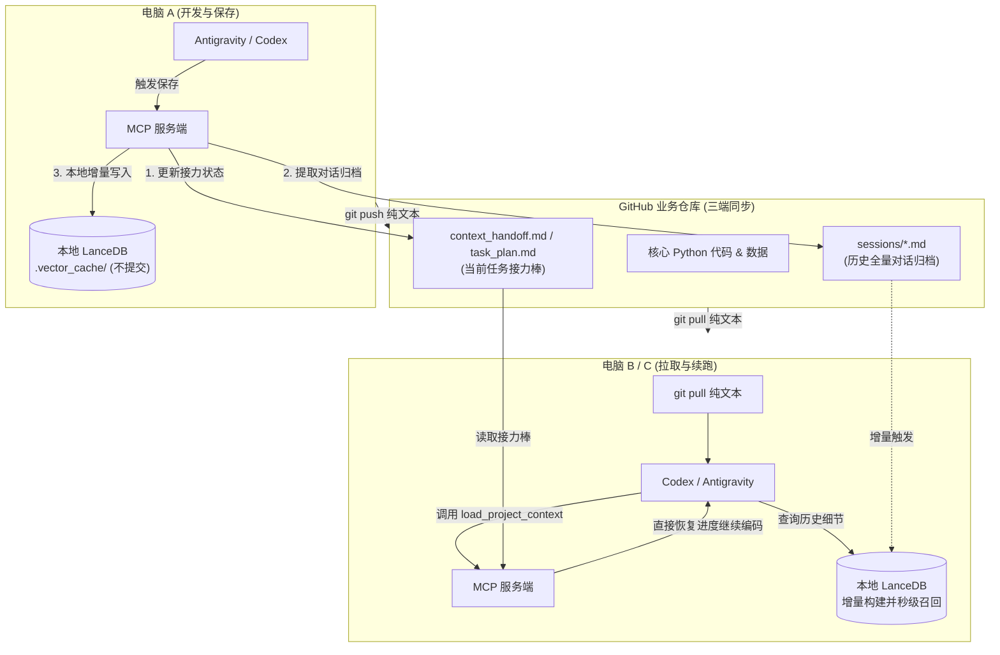

# Python MCP 跨端会话保持与增量检索实施方案规范

本方案规范定义了一个以 Python 为内核的 MCP（Model Context Protocol）服务项目，在 3 台 Windows 电脑上使用 **Antigravity** 与 **Codex** 客户端时，如何实现对话持久化、跨软件/跨电脑无缝续跑以及本地向量数据库检索。

---

## 1. 核心设计原则与架构定位

### 1.1 核心设计原则
1. **单项目内聚（Project-Scoped）**：会话记忆、断点状态与交接文档作为该代码仓库的一等公民资产管理，与业务 Python 代码和数据保持完全一致的生命周期。
2. **纯文本 Git 同步（0 冲突、极轻量）**：Git 仓库中仅流转 `Markdown` 与 `JSONL` 纯文本，彻底杜绝 SQLite / 向量索引等二进制文件提交，避免 Git 历史膨胀与多端合并冲突。
3. **本地增量向量化（LanceDB）**：每台电脑拉取代码后，在本地触发轻量增量索引（仅 1~2 秒），单机原生支持向量语义召回与 Tantivy 全文检索（FTS）。
4. **状态文件承接（Disk-based Working Memory）**：采用规范化 Markdown 文件交接当前目标、架构发现与未竟事项，取代冗余历史日志灌入，节省 Token 并消除幻觉。

### 1.2 系统架构拓扑图



---

## 2. 项目目录结构规范

在现有 Python MCP 服务端项目的基础上，增量引入以下目录和规范化文件：

```text
your-mcp-project/
├── your_mcp_server.py                 # 【核心】现有 MCP 服务端，注册 3 个会话与检索工具
├── data/                              # 现有的业务数据目录
├── context_handoff.md                 # 【交接】任务核心状态切片（目标、已完成项、架构决议、待办）
├── task_plan.md                       # 【规划】planning-with-files 标准任务计划清单
├── findings.md                        # 【决策】planning-with-files 核心技术发现与架构约束
├── progress.md                        # 【日志】planning-with-files 执行进度流水
├── sessions/                          # 【归档】全量对话纯文本归档（按时间戳与电脑端命名）
│   ├── 2026-10-24_1030_pc1_antigravity.md
│   └── 2026-10-24_1500_pc2_codex.md
├── mcp_memory/                        # 【内部模块】会话抽取与向量检索引擎
│   ├── __init__.py
│   ├── session_extractor.py           # 封装 #1 agent-session-sync 原始日志解析器
│   └── vector_engine.py               # 封装 #5 agent-memory-systems LanceDB 增量检索
├── .skills/                           # 【环境底座】随仓库同步的客户端 Skill 实体
│   ├── planning-with-files/           # 包含 .gemini / .codex 适配与 session-catchup.py
│   ├── conversation-to-prompt/        # 零散闲聊对话一键提炼 Skill
│   └── sync_skills.ps1                # 基于 #9 skill-manager 的 Windows 目录联接脚本
└── .gitignore                         # 忽略本地构建的向量库与临时缓存
```

### `.gitignore` 增量配置
```gitignore
# 忽略本地 LanceDB 数据库与分块缓存（彻底避免 Git 二进制合并冲突）
.vector_cache/
.cache/
__pycache__/
*.pyc
```

---

## 3. 核心 Skill 职责分工

| 编号与名称 | 对应开源项目 | 在本方案中的具体集成职责 |
| :--- | :--- | :--- |
| **#1 `agent-session-sync`** | `chendestiny/agent-session-sync` | **底层日志抽取器**：内置针对 Antigravity (`transcript.jsonl`) 与 Codex 会话格式的 Reader 模块，负责把异构日志提取为统一的 Markdown 纯文本。 |
| **#2 `planning-with-files`** | `othmanadi/planning-with-files` | **跨端状态接力标准**：原生适配 `.gemini` 和 `.codex`，规范 `task_plan.md`、`findings.md` 格式，驱动 AI 在切换环境后执行状态重放。 |
| **#3 `conversation-to-prompt`** | `sdcxb/codem` | **零散会话兜底提炼**：挂载在客户端中，应对未开正式计划的临时讨论，一键提炼架构约束并生成冷启动 Prompt。 |
| **#5 `agent-memory-systems`** | `findscripter/everything-skills` | **向量库架构蓝图**：提供分块切片策略（Chunking）与 LanceDB 嵌入选型规范，指导 `vector_engine.py` 实现。 |
| **#9 `skill-manager`** | `cat-xierluo/legal-skills` | **多端环境同步底座**：利用 Windows Junction 原生特性，一键将 `.skills/` 挂载到 3 台电脑的客户端扩展目录。 |

---

## 4. 核心工程实现代码

### 4.1 向量引擎与增量索引（`mcp_memory/vector_engine.py`）

遵循 `#5 agent-memory-systems` 规范，利用 LanceDB 原生 `LanceModel` + `fastembed` 实现全自动文本嵌入：

```python
"""基于 LanceDB 的本地增量会话向量化与混合检索引擎 (mcp_memory/vector_engine.py)"""
from __future__ import annotations

import hashlib
import json
from pathlib import Path
from typing import Any

import lancedb
from lancedb.embeddings import get_registry
from lancedb.pydantic import LanceModel, Vector

PROJECT_ROOT = Path(__file__).resolve().parent.parent
SESSIONS_DIR = PROJECT_ROOT / "sessions"
VECTOR_DIR = PROJECT_ROOT / ".vector_cache"
MANIFEST_FILE = VECTOR_DIR / "manifest.json"

# 使用针对中文深度优化的轻量离线模型（本地自动缓存，无需 GPU，~90MB）
embed_func = get_registry().get("fastembed").create(name="BAAI/bge-small-zh-v1.5")


class SessionChunk(LanceModel):
    id: str
    source_file: str
    text: str = embed_func.SourceField()
    vector: Vector(embed_func.ndims()) = embed_func.VectorField()


def sync_and_search(query: str, top_k: int = 5) -> list[dict[str, Any]]:
    """检测 sessions/ 新增文本文件，增量入库并执行语义搜索。"""
    VECTOR_DIR.mkdir(exist_ok=True)
    manifest = json.loads(MANIFEST_FILE.read_text(encoding="utf-8")) if MANIFEST_FILE.exists() else {}

    db = lancedb.connect(str(VECTOR_DIR / "lancedb"))
    new_chunks: list[dict[str, str]] = []

    if SESSIONS_DIR.exists():
        for file_path in sorted(SESSIONS_DIR.glob("*.md")):
            file_bytes = file_path.read_bytes()
            file_hash = hashlib.md5(file_bytes).hexdigest()
            if manifest.get(file_path.name) == file_hash:
                continue

            content = file_bytes.decode("utf-8", errors="ignore")
            # 依二级标题和轮次分块，保留自然对话语义边界
            sections = [s.strip() for s in content.split("\n## ") if s.strip()]
            for idx, chunk in enumerate(sections):
                new_chunks.append({
                    "id": f"{file_path.stem}_{idx}",
                    "source_file": file_path.name,
                    "text": chunk[:2500],  # 截断超长块保障召回质量
                })
            manifest[file_path.name] = file_hash

    # 增量入库
    if new_chunks:
        if "sessions" in db.table_names():
            table = db.open_table("sessions")
            table.add(new_chunks)
        else:
            table = db.create_table("sessions", schema=SessionChunk, data=new_chunks)
        MANIFEST_FILE.write_text(json.dumps(manifest, indent=2, ensure_ascii=False), encoding="utf-8")

    if "sessions" not in db.table_names():
        return []

    table = db.open_table("sessions")
    results = table.search(query).limit(top_k).to_list()
    return results
```

---

### 4.2 底层日志提取适配器（`mcp_memory/session_extractor.py`）

复用 `#1 agent-session-sync` 理念，自动按最后修改时间（`mtime`）定位当前活跃会话并提取：

```python
"""定位 Antigravity / Codex 本地会话并导出纯文本 Markdown (mcp_memory/session_extractor.py)"""
from __future__ import annotations

import json
import os
from pathlib import Path


def _get_latest_antigravity_transcript() -> Path | None:
    """自动探测本机 Antigravity 最新活跃会话 transcript.jsonl。"""
    local_app_data = os.environ.get("LOCALAPPDATA")
    if not local_app_data:
        return None
    # Antigravity 默认存放路径
    base = Path(local_app_data).parent / ".gemini" / "antigravity" / "brain"
    if not base.exists():
        return None
    candidates = list(base.glob("*/.system_generated/logs/transcript.jsonl"))
    if not candidates:
        return None
    return max(candidates, key=lambda p: p.stat().st_mtime)


def _get_latest_codex_session() -> Path | None:
    """自动探测本机 Codex 最新活跃会话文件。"""
    home = Path.home()
    base = home / ".codex" / "sessions"
    if not base.exists():
        return None
    candidates = [p for p in base.iterdir() if p.is_file() and p.suffix in [".json", ".md", ".jsonl"]]
    if not candidates:
        return None
    return max(candidates, key=lambda p: p.stat().st_mtime)


def export_latest_agent_session(client_type: str, output_path: Path, summary_header: str) -> None:
    """将客户端最新会话解析并保存为 Markdown 纯文本文件。"""
    lines_out = [summary_header, "\n---\n\n## 原始交互记录归档\n"]
    
    if client_type.lower() == "antigravity":
        src = _get_latest_antigravity_transcript()
        if src and src.exists():
            for line in src.read_text(encoding="utf-8", errors="ignore").splitlines():
                if not line.strip():
                    continue
                try:
                    step = json.loads(line)
                    sender = step.get("source", "UNKNOWN")
                    content = step.get("content") or ""
                    if content.strip():
                        lines_out.append(f"### [{sender}]\n{content.strip()}\n")
                except Exception:
                    continue
        else:
            lines_out.append("*(未能定位到本地 Antigravity 活跃 transcript.jsonl 文件)*\n")
            
    elif client_type.lower() == "codex":
        src = _get_latest_codex_session()
        if src and src.exists():
            lines_out.append(f"*(提取自 Codex 会话快照: {src.name})*\n\n")
            lines_out.append(src.read_text(encoding="utf-8", errors="ignore"))
        else:
            lines_out.append("*(未能定位到本地 Codex 活跃会话文件)*\n")

    output_path.parent.mkdir(exist_ok=True)
    output_path.write_text("\n".join(lines_out), encoding="utf-8")
```

---

### 4.3 MCP 服务端注册示例（`your_mcp_server.py`）

在您现有的 MCP 服务中注册 3 个原生工具：

```python
"""MCP 服务端会话保持与检索工具挂载示例 (your_mcp_server.py)"""
from datetime import datetime
from pathlib import Path

from mcp_memory.session_extractor import export_latest_agent_session
from mcp_memory.vector_engine import sync_and_search

# 假设已有 mcp 实例（如 FastMCP 或官方 Server）
PROJECT_ROOT = Path(__file__).resolve().parent


@mcp.tool()
def save_session_checkpoint(
    client_type: str,
    pc_id: str,
    current_goal: str,
    completed_items: list[str],
    key_decisions: list[str],
    next_steps: list[str],
) -> str:
    """保存当前会话断点：更新交接接力文件并归档原始对话纯文本至 sessions/。"""
    now_str = datetime.now().strftime("%Y-%m-%d %H:%M")
    file_time = datetime.now().strftime("%Y-%m-%d_%H%M")

    # 1. 写入任务接力文档 context_handoff.md（对齐 #2 planning-with-files 规范）
    handoff_md = (
        f"# 项目任务交接单 (更新时间: {now_str} | 设备: {pc_id} | 工具: {client_type})\n\n"
        f"## 1. 核心目标\n{current_goal}\n\n"
        f"## 2. 本次已完成项\n" + "\n".join(f"- [x] {item}" for item in completed_items) + "\n\n"
        f"## 3. 架构决策与技术发现\n" + "\n".join(f"- {dec}" for dec in key_decisions) + "\n\n"
        f"## 4. 下一步待办清单 (Next Steps)\n" + "\n".join(f"- [ ] {step}" for step in next_steps) + "\n"
    )
    (PROJECT_ROOT / "context_handoff.md").write_text(handoff_md, encoding="utf-8")

    # 2. 调用 session_extractor 提取原始会话并落盘
    sessions_dir = PROJECT_ROOT / "sessions"
    sessions_dir.mkdir(exist_ok=True)
    archive_file = sessions_dir / f"{file_time}_{pc_id}_{client_type}.md"
    export_latest_agent_session(client_type=client_type, output_path=archive_file, summary_header=handoff_md)

    return f"断点已写入 context_handoff.md，会话已归档至 sessions/{archive_file.name}"


@mcp.tool()
def load_project_context() -> str:
    """跨端恢复对话：读取最新的交接状态与断点，供新会话秒级冷启动。"""
    handoff_path = PROJECT_ROOT / "context_handoff.md"
    if not handoff_path.exists():
        return "当前暂无交接记录，这是一个全新起点。"
    return handoff_path.read_text(encoding="utf-8")


@mcp.tool()
def search_session_history(query: str, top_k: int = 5) -> str:
    """检索项目历史对话：自动增量索引 sessions/ 并在 LanceDB 中执行语义搜索。"""
    results = sync_and_search(query=query, top_k=top_k)
    if not results:
        return "未检索到匹配的历史对话细节。"
    formatted = [f"【来源: {r['source_file']}】\n{r['text']}" for r in results]
    return "\n\n---\n\n".join(formatted)
```

---

## 5. Windows 三端部署脚本（`.skills/sync_skills.ps1`）

在 Windows 电脑上运行此脚本，利用 NTFS 目录联接（Junction）免提权将 Skill 链接到两大工具目录：

```powershell
# .skills/sync_skills.ps1
[CmdletBinding()]
param()

$ProjectSkills = $PSScriptRoot
$GeminiSkills  = Join-Path $HOME ".gemini\skills"
$CodexSkills   = Join-Path $HOME ".codex\skills"

New-Item -ItemType Directory -Force -Path $GeminiSkills, $CodexSkills | Out-Null

$Targets = @("planning-with-files", "conversation-to-prompt")

foreach ($skill in $Targets) {
    $src = Join-Path $ProjectSkills $skill
    if (-not (Test-Path $src)) {
        New-Item -ItemType Directory -Force -Path $src | Out-Null
    }

    $links = @(
        (Join-Path $GeminiSkills $skill),
        (Join-Path $CodexSkills $skill)
    )

    foreach ($dst in $links) {
        if (Test-Path $dst) {
            $item = Get-Item $dst -Force
            # 如果已是 Junction 目录联接则跳过，普通空文件夹则清理后重连
            if ($item.Attributes -band [System.IO.FileAttributes]::ReparsePoint) {
                Write-Host "已存在目录联接: $dst" -ForegroundColor DarkGray
                continue
            }
            Remove-Item -Recurse -Force $dst
        }
        cmd /c mklink /J "$dst" "$src" | Out-Null
        Write-Host "已建立目录联接: $dst -> $src" -ForegroundColor Green
    }
}
Write-Host "所有核心 Skill 已挂载至 Antigravity 与 Codex！" -ForegroundColor Cyan
```

---

## 6. 日常跨电脑标准流转工作流（SOP）

### 场景：在电脑 A（Antigravity）开发完成，切至电脑 B（Codex）接力

1. **电脑 A 结束时**：
   - 对 Antigravity 输入：`保存当前会话进度`。
   - MCP 自动调用 `save_session_checkpoint`，刷新 `context_handoff.md` 并写入 `sessions/2026-10-24_1030_pc1_antigravity.md`。
   - 终端提交并推送：
     ```powershell
     git add .
     git commit -m "feat: 更新业务逻辑与会话断点"
     git push
     ```

2. **电脑 B 开始时**：
   - 终端拉取最新代码与会话纯文本：
     ```powershell
     git pull
     ```
   - 打开 Codex，直接发起对话：`恢复上一次项目会话进度`。
   - Codex 自动读取 `context_handoff.md`，获知上一台电脑在 Antigravity 中修改的文件和下一步待办，**无需重发冗余历史记录，无缝接续**。

3. **跨端检索历史细节**：
   - 随时在任一客户端提问：`查一下之前在电脑 1 上讨论的某参数边界值`。
   - MCP 触发 `search_session_history`，LanceDB 在本地以 1 秒极速增量吸收最新拉取的文件并完成语义精准召回。
