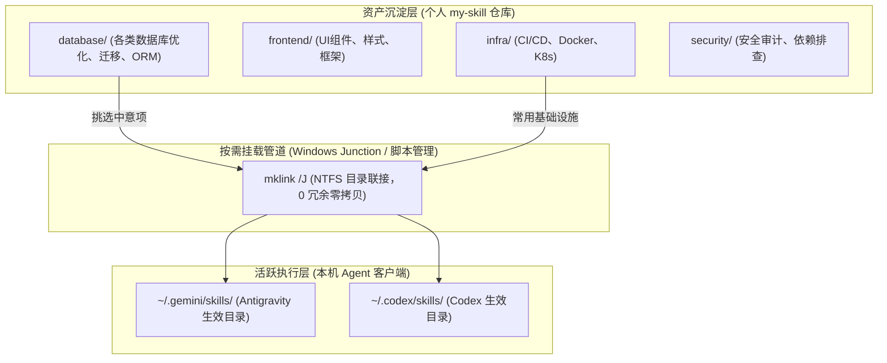

# 个人 Skill 仓库与分层挂载方案

日期：2026-10-24  
状态：设计记录与实施方案  
定位：定义个人 Skill 资产的“分类收藏库”与“本机活跃挂载区”两层解耦架构。

---

## 一、 核心设计诉求

- **避免全量膨胀**：改变“所有发现的 Skill 都直接克隆/拉取到本地执行端”的模式，防止本地客户端上下文窗口和工具列表臃肿。
- **两层职责分离**：
  1. **资产沉淀层（分类收藏）**：构建个人 Skill 资产中心（如 `my-skill`），按技术垂直领域（数据库、前端、架构等）分类归档与集中维护。
  2. **活跃执行层（按需挂载）**：仅将高频使用或当前项目必需的 Skill 挂载至本机的 Agent 运行环境，即用即挂、用完可卸。

---

## 二、 架构模型设计



---

## 三、 两层体系详细规范

### 1. 资产沉淀层（分类收藏库）
- **形态**：独立的 Git 仓库（如 `my-skill`），作为个人资产库长期沉淀。
- **分类方式**：按技术领域建立子目录：
  ```text
  my-skill/
  ├── database/
  │   ├── pg-optimizer/
  │   └── redis-cache-patterns/
  ├── frontend/
  ├── devops/
  ├── registry.json        # 资产清单与分类元数据
  └── sync.ps1             # 挂载管理脚本
  ```
- **存储内容**：保留 Skill 完整的 `SKILL.md`、辅助脚本与使用文档。

### 2. 活跃执行层（本机挂载区）
- **形态**：AI 客户端的全局 Skill 目录（如 Windows 下的 `$HOME\.gemini\skills` 和 `$HOME\.codex\skills`）。
- **挂载机制**：采用 Windows NTFS 目录联接（Junction，`mklink /J`）：
  - **零磁盘冗余**：不复制物理文件，直接指针引用，修改一处两端同步；
  - **免管理员提权**：普通用户权限即可创建与移除；
  - **环境轻量隔离**：客户端只看到被联接的少量活跃 Skill，降低模型决策干扰。

---

## 四、 操作实现与流程示例

### 1. 挂载常用技能（以数据库优化技能为例）
```powershell
# 将 my-skill/database/pg-optimizer 挂载至 Antigravity
cmd /c mklink /J "$HOME\.gemini\skills\pg-optimizer" "D:\Code_Projects\my-skill\database\pg-optimizer"

# 同步挂载至 Codex
cmd /c mklink /J "$HOME\.codex\skills\pg-optimizer" "D:\Code_Projects\my-skill\database\pg-optimizer"
```

### 2. 卸载不再活跃的技能
```powershell
# 仅移除目录联接，不影响 my-skill 仓库内的原始文件
Remove-Item "$HOME\.gemini\skills\pg-optimizer" -Force
Remove-Item "$HOME\.codex\skills\pg-optimizer" -Force
```

---

## 五、 方案可行性结论

**完全可行且符合最佳实践**：
1. **轻量可控**：收藏库可容纳成百上千个 Skill，而本机 Agent 仅保持 5~10 个高频常备项。
2. **多端一致**：配合 Git 同步 `my-skill` 仓库后，各台电脑可通过简单的配置脚本一键切换本机的活跃 Skill 集合。
